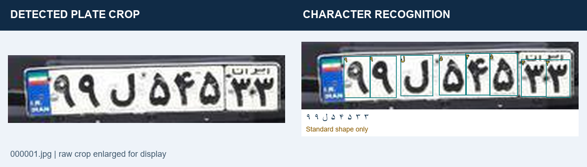
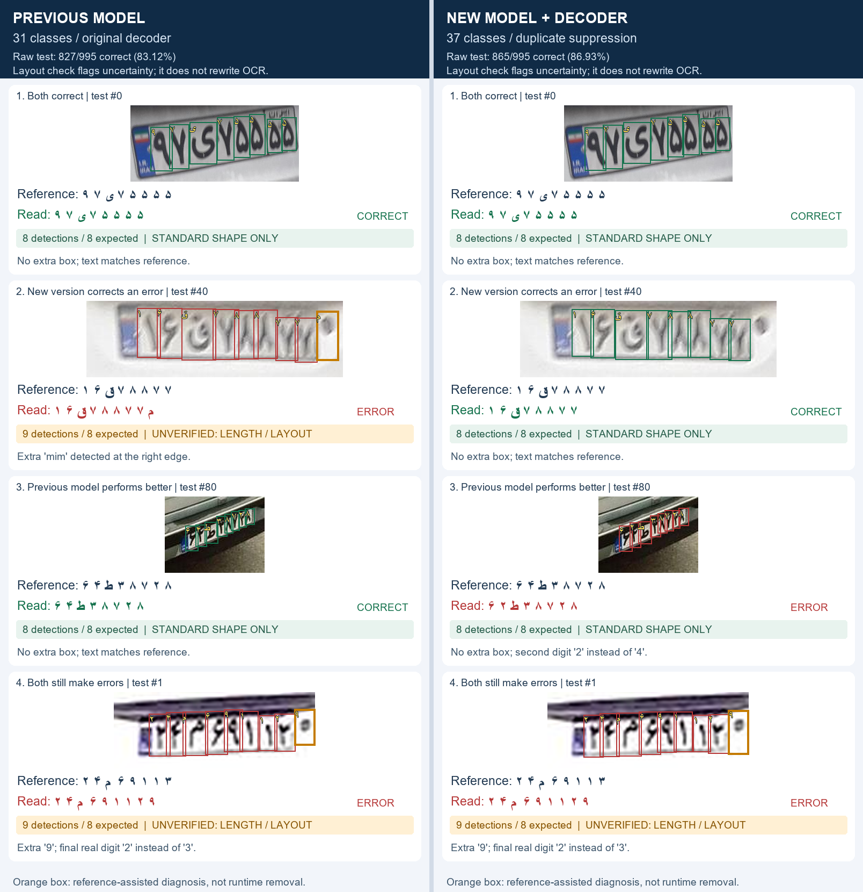
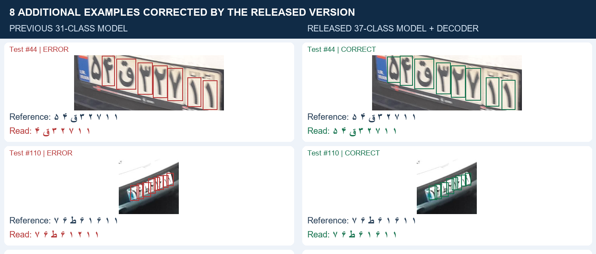
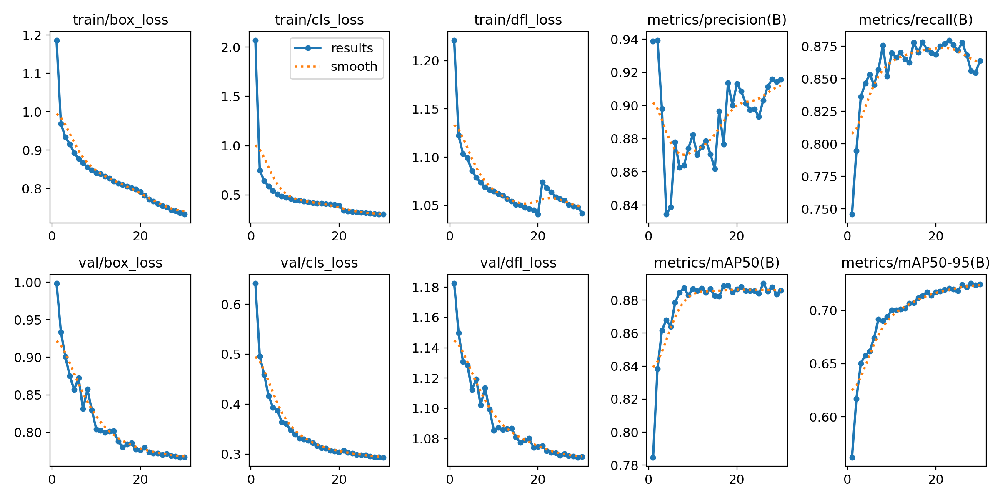

# Iranian License Plate Recognition (LPR) Model


## 📖 Project Context

A two-stage Persian license plate recognition prototype for a broader **weighbridge (Baskool) automation** project: locate a plate in a camera frame, crop it, detect its characters and decode the text. Benchmark results below measure recognition on already-cropped plates; they do not certify the full camera pipeline for industrial use.

## Sample output — detected plate crop and character reading

**Left:** the clean plate crop produced by `plate_detector.pt` from a full vehicle image. **Right:** retained character boxes and text from the released `chars37-best.pt` model on that exact crop. This is the cropped output of the two-stage pipeline; the character model receives the crop, not the full vehicle frame.



These are actual inference outputs, enlarged only for display. No fixed character count or guessed characters were used. The image is a demonstration, not a new accuracy measurement; "Standard shape only" checks text layout and does not certify the reading.

[View all five cropped outputs](training_results/cropped-output-2026-11-04/all-cropped-outputs.png) · [Source images, settings and results](training_results/cropped-output-2026-11-04/README.md)

## 🆕 v0.2.0 — model and OCR decoding improvements

Download [v0.2.0 and its character weights](https://github.com/Amir-chi/Iranian-Plate-Recognition-Model/releases/tag/v0.2.0). The updated model has 37 output classes. A validation-selected decoder removes competing overlapping character detections before composing the plate string.

**HezarAI designated test split — 995 identical plate crops:**

| Version | Entire plate read correctly | Exact-match rate |
|---|---:|---:|
| Previous 31-class model + original decoder | 827 / 995 | 83.12% |
| New 37-class model + original decoder | 849 / 995 | 85.33% |
| New model + validated duplicate suppression | **865 / 995** | **86.93%** |

The combined change reads **38 additional plates correctly (+3.82 percentage points)**. Decoder improvement alone adds 16 correct plates; candidate text character edit rate falls from 3.15% to 2.80%. These percentages are **full-string exact match**, not detection mAP. The old baseline weight remains available.

All 9,953 HezarAI images were evaluated; its train and validation splits are reported separately as supplementary evaluations. No training on HezarAI was performed. The 63 decoder configurations were selected using validation, then evaluated with the frozen settings on test. A repeated square-letterbox run confirmed the counts. The test has now been inspected and should not be reused to choose further configurations.

**Mixed evidence is documented:** on the earlier original-real IR-LPR test, candidate mAP50 was **94.11% vs 94.77%** for the baseline. This release therefore claims improvement on the reported HezarAI benchmark, not universal superiority or proven performance for every rare class.

Read the [changelog](CHANGELOG.md), [model card](MODEL_CARD.md) and [experiment index](training_results/README.md) for evidence and limitations.

### Previous vs new: actual predictions on the same images

Left: original 31-class model and decoder. Right: v0.2.0 37-class model with the validated decoder. Both columns use the **same four HezarAI test crops**. Green means the entire predicted text matches the dataset reference; red means at least one character differs. Boxes show retained character detections, not full-frame plate localization.



Each panel now includes the character count and layout status. **9 detections** flag the extra-character cases; **8 detections can still contain a wrong digit**, as test #80 shows. Orange edge boxes are reference-assisted explanations of extra detections; the runtime check flags uncertainty and does not automatically remove them. [Per-image diagnosis](training_results/model-comparison-2026-11-04/README.md#character-count-and-layout-diagnostics).

These are illustrative examples: the first test image in each category (both correct, new version corrects an error, previous model better, both wrong). They are not a random sample or a replacement for the 995-image benchmark. The new version improves the aggregate score while still failing on some plates.

[Previous-model image](training_results/model-comparison-2026-11-04/previous-predictions.png) · [New-version image](training_results/model-comparison-2026-11-04/new-predictions.png) · [Example selection and provenance](training_results/model-comparison-2026-11-04/README.md)

### More examples where the released version improves

On all 995 matched test crops, the release corrects **49 previous errors** and introduces **11 regressions**, for a net gain of 38 complete correct plates. The following preview shows two additional improvements; the linked gallery includes eight improvements, two regressions and two shared failures. These are selected illustrations from the same test, not a new holdout or a random sample.



[Eight additional improvements and remaining failures](training_results/additional-comparison-2026-11-04/README.md)

## 🏗️ Architecture & Methodology

1. **Plate localization:** the existing `models/plate_detector.pt` locates a plate in a full frame. Its source is [SMSajadi99/Custom-Data-YOLOv8-Iranian-license-plates](https://github.com/SMSajadi99/Custom-Data-YOLOv8-Iranian-license-plates).
2. **Character recognition:** a YOLOv8-Nano detector predicts character boxes on the clean crop. `plate_ocr.py` removes competing overlapping boxes, sorts by horizontal center and normalizes Persian text. No expected string length or missing character is guessed.

The new default, when its separate asset is installed, is `models/chars37-best.pt`. Otherwise the app falls back to `models/best.pt` and prints the selected path. Input size remains **640**, confidence **0.25**, duplicate IoU **0.5**; larger inputs at 800/960 did not improve the validation winner. Display overlays are drawn after extracting clean input pixels.

The camera demo marks unsupported two-digits / one-letter / five-digits text shapes in orange as **unverified layout**. It preserves raw OCR text; a matching shape is not proof of correct recognition. Other plate types and incomplete crops require separate validation. This uncertainty check does not change the raw benchmark scores above.

## 📂 Repository structure

```text
main.py                         Camera demo and model selection
plate_ocr.py                    Shared character-to-text decoding
plate_pipeline.py               Shared full-frame detection, clean crop and character recognition
read_image.py                   Save both inference stages and JSON results for image files
models/
  plate_detector.pt             Existing full-frame plate locator
  best.pt                       Original 31-class character baseline
  chars37-best.pt               New weight: download from release, not tracked in Git
train.py                       Character-detector training / evaluation
prepare_ir_lpr.py              Source XML conversion, normalization and deduplication
training_results/
  README.md                     Experiment and metric index
  metrics.png, results.csv, ...  Original baseline experiment, preserved
  ferdowsi-2026-10-31/           Recorded 37-class run and configuration
  local-source-test-2026-11-01/  Direct source-ZIP evaluation
  hezarai-2026-11-01/            Full-plate OCR benchmark
  ocr-improvement-2026-11-01/    Validation selection and decoder results
docs/TRAINING_REPORT.md         Complete training methodology and findings
MODEL_CARD.md                   Model identity, task and limitations
CHANGELOG.md                    Release changes and measured gains
TRAINING.md                     Operational training instructions
```

## 📂 Dataset & Preprocessing

Training source: [mut-deep/IR-LPR](https://github.com/mut-deep/IR-LPR), including its License Plate + Dummy License Plate archives. `prepare_ir_lpr.py` normalizes character aliases, converts XML boxes to YOLO labels, preserves original split ownership by image SHA256, and rejects invalid annotations and exact duplicates.

| Prepared split | Real images | Synthetic images | Total |
|---|---:|---:|---:|
| Train | 19,273 | 26,000 | 45,273 |
| Validation | 2,763 | 2,600 | 5,363 |
| Test | 5,542 | 0 | 5,542 |

The original [processed dataset download](https://drive.google.com/file/d/1SH-YcGGjrxnEaOJoqu3_XKrHmVjv2xqI/view?usp=sharing) is the **older 31-class preparation**, not the new 37-class tree. Full datasets are outside this repository; `dataset_samples/` is not the complete training set. The [preparation report](training_results/ir_lpr_preparation_report.json) records exclusions and archive hashes.

External OCR benchmark: [HezarAI Persian License Plate](https://huggingface.co/datasets/hezarai/persian-license-plate-v1), with image/text pairs. No exact byte/pixel overlaps with prepared IR-LPR were found, but near-duplicate independence and unknown baseline pretraining overlap are not proven. Upstream usage terms continue to apply.

## 📊 Training Results & Reports

The 37-class training run completed **7 epochs**, selected **epoch 2**, and stopped after five epochs without improvement. The adaptive target of 25 epochs was not the number executed. The run used AdamW, batch 32, imgsz 640, initial learning rate 0.0001, RTX 3080 Ti, torch 2.5.1+cu121 and Ultralytics 8.4.8.

- [Complete training report](docs/TRAINING_REPORT.md): reproducibility, hyperparameters, split ownership, original-real comparison and experiment plan.
- [HezarAI OCR report](training_results/hezarai-2026-11-01/REPORT.md): all split results, full-string accuracy, CER and paired uncertainty.
- [Decoder improvement report](training_results/ocr-improvement-2026-11-01/REPORT.md): 63 validation configurations, selected settings, test result and code verification.
- [Direct source-ZIP report](training_results/local-source-test-2026-11-01/REPORT.md): separate class-support comparison; not a fresh independent dataset.

### Historical baseline evidence

The original repository's 30-epoch baseline artifacts remain at their original paths. Its reported mAP50 was 88.592%, precision 91.555% and recall 86.389%. These historical detection metrics are not directly comparable to the new full-plate text exact-match percentages.

[Original baseline validation predictions](training_results/val_batch0_pred.jpg) are retained as historical evidence. For the previous/new visual comparison, use the matched examples above.



*Original baseline training curves, preserved for provenance. New experiments have separate dated directories.*

## 🚀 Installation & Usage

```bash
git clone https://github.com/Amir-chi/Iranian-Plate-Recognition-Model.git
cd Iranian-Plate-Recognition-Model
python -m venv .venv
# Activate the environment using your shell's activation command.
# Install a PyTorch build suitable for your CPU/GPU first.
python -m pip install -r requirements-app.txt
```

`requirements.txt` is the historical environment snapshot, including CUDA-specific pins and both GUI/headless OpenCV packages; use `requirements-app.txt` for a fresh camera-demo installation after selecting PyTorch.

Download `chars37-best.pt` from [v0.2.0](https://github.com/Amir-chi/Iranian-Plate-Recognition-Model/releases/tag/v0.2.0) and place it under `models/`. The app also needs the existing `models/plate_detector.pt`. The original baseline remains `models/best.pt`.

```bash
python main.py
```

For an image or directory, save the actual detected crop, character boxes, text and full-frame localization:

```bash
python read_image.py path/to/car.jpg --output runs/image-inference
```

The image command and camera demo share `plate_pipeline.read_plates`. Character boxes in `results.json` are relative to the clean crop; add the crop offsets to map them onto the full frame. No detected plate is recorded as an empty plate list. No character count is forced.

The demo uses camera index 0, requires a graphical desktop and exits with `q`. Camera inference and target-site behavior still require validation; existing OpenCV overlays are not a full Persian GUI renderer.

## Android model assets

The same released models are available as [NCNN FP16 assets](https://github.com/Amir-chi/Iranian-Plate-Recognition-Model/releases/download/v0.2.0/v0.2.0-android-ncnn-fp16.zip) for native Android integration. Both model payloads total **28.54 MB**; this is a format conversion, not a new trained model or an APK. The character export matched all 995 PyTorch test strings on the desktop CPU. The full NCNN pipeline also matched the five earlier demonstration readings.

Smaller character inputs reduced validation full-plate accuracy and were not adopted. **Phone latency, memory and battery use remain unmeasured.** See the [Android guide and measured limits](docs/ANDROID.md) and [export evidence](training_results/mobile-export-2026-11-04/summary.json).

## Training & Verification

Install a suitable CUDA-enabled PyTorch build before `requirements-train.txt`. Preparation requires Python 3.11+ and the original split data described in the [reproduction instructions](docs/TRAINING_REPORT.md#reproduction-and-evidence). Live-demo weights must not be overwritten during experiments.

```bash
python -m pip install -r requirements-train.txt
python -m unittest discover -v
```

The release preparation passed 17 unit tests. The camera recognition helper was also checked on 20 real test crops against the calibrated batch decoder. These checks do not establish full-camera recognition accuracy.

## 🤝 Acknowledgements

- Dataset and paper: [mut-deep/IR-LPR](https://github.com/mut-deep/IR-LPR).
- Original plate locator: [SMSajadi99/Custom-Data-YOLOv8-Iranian-license-plates](https://github.com/SMSajadi99/Custom-Data-YOLOv8-Iranian-license-plates).
- External OCR benchmark: [HezarAI](https://huggingface.co/datasets/hezarai/persian-license-plate-v1).
- Detector implementation: [Ultralytics](https://github.com/ultralytics/ultralytics).

See upstream terms and citation guidance before redistributing or deploying third-party data, software or weights. No new license is asserted for upstream artifacts.
