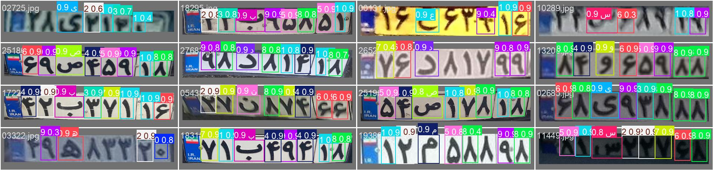

# Iranian License Plate Recognition (LPR) Model


---

## 📖 Project Context

> **Note:** This project serves as a **foundational prototype** and a proof-of-concept for a more advanced, industrial-grade Weighbridge (Baskool) automation system that is currently under development.

The objective of this repository is to demonstrate an end-to-end pipeline for Persian license plate recognition, covering data preprocessing, model training, and a robust 2-stage inference logic suitable for real-world applications.

---

## 🏗️ Architecture & Methodology

To ensure high accuracy and stability, this project utilizes a **2-Stage Detection Pipeline**:

### 1. Stage 1: Plate Localization

* **Goal:** Detects the bounding box of the license plate within the full video frame.
* **Model Source:** We utilized a pre-trained model from the
  **Custom-Data-YOLOv8-Iranian-license-plates** repository, which offers strong localization performance for Iranian plates.

### 2. Stage 2: Character Recognition (OCR)

* **Goal:** Crops the detected plate region and identifies individual Persian characters and numbers.
* **Model Source:** A custom **YOLOv8-Nano** model trained specifically for this project on personal hardware.

---

## 📂 Dataset & Preprocessing

The training data for the character recognition model (Stage 2) was derived from a high-quality raw dataset.

* **Original Source:**
  Raw images and XML annotations from the **IR-LPR** repository.
* **Preprocessing:**
  A custom Python script was developed to:

  * Convert XML annotations to YOLO TXT format
  * Split data into Train/Validation/Test sets
* **Processed Dataset:**
  The ready-to-train dataset is available at the link below:

☁️ **[Download Processed Dataset (Google Drive)](https://drive.google.com/file/d/1SH-YcGGjrxnEaOJoqu3_XKrHmVjv2xqI/view?usp=sharing)**

---

## 📊 Training Results

The character recognition model was trained locally. Detailed logs, confusion matrices, and loss curves can be found in the [`training_results`](training_results/) folder of this repository.

### Sample Detection

*Figure 1: Visual demonstration of the model's inference on the validation set, showcasing accurate bounding box localization and character classification.*

### Training Metrics

*Figure 2: Comprehensive training logs over 30 epochs, indicating steady loss convergence and high mAP@50 scores.*

<div align="center">

| Metric | Score | Description |
| :--- | :--- | :--- |
| **mAP@50** | **88.592%** | Overall model accuracy at 0.5 IoU |
| **Precision** | **91.555%** | Correctness of positive character detections |
| **Recall** | **86.389%** | Ability to find all characters in the plate |
| **Speed** | **Real-time** | Optimized for high-speed industrial inference |

<sub><em><b>Table 1:</b> Final performance metrics of the character recognition model after 30 epochs of training on the processed dataset.</em></sub>

</div>

---

## 🚀 Installation & Usage

### 1. Clone the Repository

```bash
git clone https://github.com/Amir-chi/Iranian-Plate-Recognition-Model.git
cd Iranian-Plate-Recognition-Model
```

---

### 2. Install Dependencies

```bash
pip install -r requirements.txt
```

---

### 3. Setup Models

Place the model weights inside the `models/` directory:

* `plate_detector.pt` → Stage 1 plate detection model
* `best.pt` → Trained character recognition model

---

### 4. Run Inference

Start the webcam detection:

```bash
python main.py
```

---

## 🤝 Acknowledgements

Special thanks to the open-source community for the resources that made this prototype possible:

* **Dataset Source:** [mut-deep/IR-LPR](https://github.com/mut-deep/IR-LPR.git)
* **Plate Detector Model:** [SMSajadi99/Custom-Data-YOLOv8](https://github.com/SMSajadi99/Custom-Data-YOLOv8-Iranian-license-plates.git)
