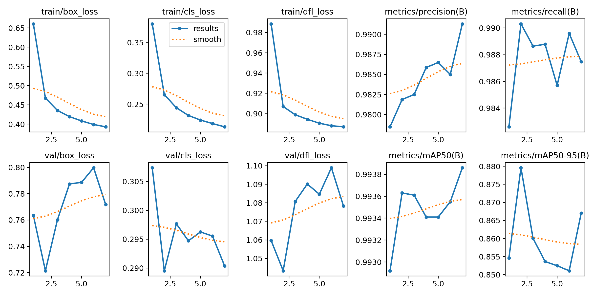

# Character detector training report — 31 October 2026

## Decision

Do not resume the same run with unchanged settings, and keep the existing `models/best.pt` as the application default. The candidate improves real-only validation but regresses on real-only test. Additional epochs alone are not supported by the recorded learning curve. The expanded model remains an experimental candidate for the six added classes.

**Correction to the earlier progress report:** 25 was an adaptive epoch target, not the number completed. The CSV contains **7 completed epochs**. Early stopping fired after five epochs without improving the selection metric; **epoch 2** produced `best.pt`. The recorded training duration is 0.404 hours (about 24.2 minutes), excluding preparation and final evaluations. The completion event and `TRAINING_COMPLETE` marker confirm a successful finish, rather than an interrupted run.

## Scope and starting model

This run fine-tunes the YOLOv8 character detector on cropped license plates. It does not train the full-image plate locator and does not measure end-to-end plate-string accuracy. The baseline has 31 classes. Six classes were appended: `D`, `S`, `ف`, `ک`, `گ`, `تشریفات`. Existing class IDs and corresponding output weights/biases are preserved by `extend_character_head()` in `train.py`. The expanded model has approximately 3.01 million parameters.

Baseline weight SHA256: `dc8e83b4442d6d88a47083c69cf9c65c99fb0fc37162e64e941088e35821ffa5`.

Candidate best weight SHA256: `5ab6da27dedafc06f6c69d29c297d9f270c24fa5f0130d1d15fff40ebe9d56c8`.

## Data provenance and preparation

The original project README points to [IR-LPR](https://github.com/mut-deep/IR-LPR) and an older [31-class prepared dataset](https://drive.google.com/file/d/1SH-YcGGjrxnEaOJoqu3_XKrHmVjv2xqI/view). This experiment uses the official **License Plate + Dummy License Plate** archives, converted by `prepare_ir_lpr.py`.

| Split | Real images | Synthetic images | Total prepared |
|---|---:|---:|---:|
| Train | 19,273 | 26,000 | 45,273 |
| Validation | 2,763 | 2,600 | 5,363 |
| Test | 5,542 | 0 | 5,542 |

Preparation normalizes equivalent character spellings, validates bounding boxes, excludes 231 invalid items and removes 77 byte-identical duplicates. Original split ownership is preserved by image SHA256 with test/validation priority. This controls exact byte duplication, not vehicle identity or similar video frames. The [preparation report](../training_results/ir_lpr_preparation_report.json) records counts, class distribution, archive hashes and exclusions.

The server downloaded original public archives and checked their SHA256 against that report. Prepared labels were transferred separately with a verified checksum; images were placed by their SHA256 filenames. All **56,178** prepared images matched their labels. Ultralytics applies additional image checks: at least one 9×43 validation image was rejected because a dimension was below 10 pixels. Prepared counts therefore need not equal effective evaluation counts.

The real-only comparison manifests contain 2,755 validation and 5,499 test images from the original real dataset and retain the 31 shared classes. They do not establish real-world performance for the six new classes. Source archives, image data and weights are not embedded in this report; consult upstream terms before redistributing them. No new license is asserted for upstream data or weights.

## Execution and configuration

- Ferdowsi Tehran VM: RTX 3080 Ti 12 GB, 16 vCPU, 32 GB RAM, Ubuntu 22.04.
- Python 3.10.12, PyTorch 2.5.1+cu121, torchvision 0.20.1, Ultralytics 8.4.8; NVIDIA driver 580.178.04.
- Image size 640, batch 32, four loader workers, image cache disabled, AMP enabled, seed 0, deterministic mode requested.
- AdamW, initial learning rate 0.0001, cosine schedule, one warmup epoch, warmup bias learning rate 0.
- Horizontal/vertical flips, mosaic and mixup disabled. Other settings are in the recorded [args.yaml](../training_results/ferdowsi-2026-10-31/chars37/args.yaml).
- Initial epoch argument 60; time budget 1.4252 hours; patience 5; checkpoint every epoch. Ultralytics recalculates the epoch target in timed mode, so 60 is not a hard maximum in this configuration.
- First optimization batches: 19:01 UTC / 22:31 Tehran, 31 October. Completion event: 19:27 UTC / 22:57 Tehran that day.

The recorded hourly plan rate was 62,100 toman. Multiplying that by 24.2 training minutes gives roughly 25,100 toman for the training loop alone; this is **not an invoice** and excludes provisioning, dependency installation, evaluations, idle time and storage. Training ran under systemd, independent of SSH. Logs and per-epoch weights were written to disk. OS shutdown was configured after process exit plus a separate deadline; provider powered-off state must be checked, and disk charges continue while retained.

## Results

All values below are percentages. Precision and recall are the evaluator's reported operating-point metrics; mAP is character-box detection AP, not the percentage of complete plates read correctly.

| Real-only split | Model | Precision | Recall | mAP50 | mAP50–95 |
|---|---|---:|---:|---:|---:|
| Validation | Baseline (31 classes) | 89.05 | 87.13 | 88.41 | 72.84 |
| Validation | Candidate (37 classes) | 93.46 | 92.06 | 92.15 | 73.35 |
| Test | Baseline (31 classes) | 97.80 | 92.25 | 94.77 | 77.71 |
| Test | Candidate (37 classes) | 96.39 | 92.86 | 94.11 | 75.20 |

Validation deltas: **+3.74 pp mAP50**, **+0.51 pp mAP50–95**. Test deltas: **−0.66 pp mAP50**, **−2.50 pp mAP50–95**, with slightly higher recall but lower precision. Rounding differences may affect the last displayed digit.

The mixed real/synthetic validation used during training is a different evaluation set from the real-only comparison. Its epoch-2 mAP50 is 99.363% and mAP50–95 is 87.960%. These values must not be presented as real-only test accuracy.

| Epoch | Elapsed training seconds | Mixed-val mAP50–95 | Train box loss | Val box loss |
|---|---:|---:|---:|---:|
| 1 | 212.465 | 85.463 | 0.66076 | 0.76356 |
| 2 (selected) | 415.073 | 87.960 | 0.46777 | 0.72146 |
| 3 | 621.414 | 86.007 | 0.43574 | 0.76024 |
| 4 | 825.805 | 85.364 | 0.41961 | 0.78739 |
| 5 | 1035.230 | 85.247 | 0.40848 | 0.78862 |
| 6 | 1248.140 | 85.108 | 0.39921 | 0.79971 |
| 7 | 1455.360 | 86.706 | 0.39315 | 0.77172 |



Training loss continues falling while the validation criterion fails to regain its epoch-2 peak. This is consistent with overfitting or a train/evaluation distribution mismatch, but one run cannot establish the cause. The synthetic majority (57.4% of training images) is a hypothesis to investigate, not a proven explanation. No repeated seeds, confidence intervals, vehicle-level split audit or end-to-end camera benchmark were performed.

## Proposed next experiment

1. Keep the baseline in production and archive the candidate. Do not increase epochs as the sole change.
2. Reserve a fresh real holdout (preferably grouped by vehicle/capture session). The existing test results have now been inspected, so repeated tuning against this test would compromise its role as an untouched final holdout.
3. On validation only, compare real-only training against a reduced synthetic proportion, preserving class coverage. Use a small fixed budget and change one factor at a time. A lower learning rate can be a separate ablation, not a guaranteed fix.
4. Add real validation examples for the six new classes and report per-class support/AP before claiming the 37-class expansion is useful. Synthetic-only coverage is insufficient for that claim.
5. Choose the checkpoint using a predefined real-validation criterion, then evaluate a frozen candidate once on the fresh holdout and on full plate-string recognition. Require a practical benefit before replacing the baseline.

This is an experiment plan; no further paid training was started during this review.

## Reproduction and evidence

Use Python 3.11+ on the preparation host (`hashlib.file_digest` is used), install a suitable PyTorch build, then install `requirements-train.txt`. The source archives and original `raw_dataset` split directories are required. Prepare into a new directory:

```bash
python prepare_ir_lpr.py --download --downloads runs/datasets/ir-lpr/downloads --output runs/datasets/ir-lpr/ready --base-data ../Iranian-Plate-Processing-Model-TRAIN_FOLDER/ready_dataset/data.yaml
python train.py --data runs/datasets/ir-lpr/ready/data.yaml --real-data runs/datasets/ir-lpr/ready/real.yaml --weights models/best.pt --project runs/ferdowsi-reproduction --name chars37 --epochs 60 --batch 32 --workers 4 --device 0 --time-hours 1.4252 --patience 5 --save-period 1
```

Preparation writes absolute paths for its host. To train on another host, copy the ready tree, rewrite manifest entries from the old `/ready/` root to the destination root, and update the YAML `path` before calling `train.py`. `train.py` resolves paths but does not automatically migrate Windows absolute manifests to Linux. Original paths in recorded `args.yaml` describe the historical run and are not a portable launch configuration. Exact numerical reproducibility across GPUs and package versions is not promised.

Evidence in [training_results/ferdowsi-2026-10-31](../training_results/ferdowsi-2026-10-31):

- `comparison.json`: raw real-only evaluation metrics.
- `chars37/results.csv`: seven completed epochs and learning-rate/loss history.
- `chars37/args.yaml`: recorded trainer arguments.
- `training-completion.txt`: early-stopping and successful completion markers.
- `training-environment.txt`: observed package inventory (includes system packages; not a clean requirements lockfile).
- `status.json`, `events.jsonl`: execution stages and completion event.
- `chars37/results.png`, `BoxPR_curve.png`, `confusion_matrix_normalized.png`: mixed-validation plots, not real-test plots.

Credentials, SSH keys, chat identifiers and account details are excluded from the documentation. The candidate weights should be distributed separately only after reviewing the model and dataset terms.
