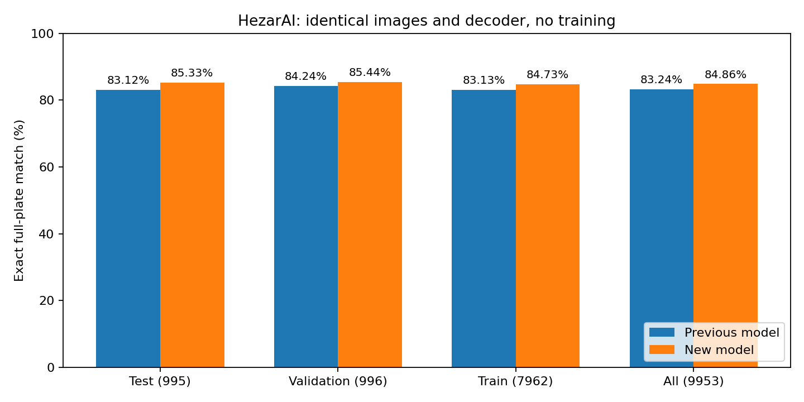

# Experiment index

This folder preserves the original baseline artifacts and adds separate, dated evidence directories. Percentages are not interchangeable: detection mAP measures character boxes, while OCR exact match requires an entire normalized plate string to match.

For the displayed cropped product output, see [detected plate crops and character recognition](cropped-output-2026-11-04/README.md): five actual full-frame → crop → character-reading examples using the released weights.

| Experiment | Task / scope | Key finding | Evidence |
|---|---|---|---|
| Original baseline, 30 epochs | Character-box detection, original validation | Reported mAP50 88.592%; historical provenance only | [CSV](results.csv), [curves](metrics.png), [sample](val_batch0_pred.jpg) |
| 31 October 2026 training | 31 → 37 classes; real + synthetic IR-LPR | Seven epochs, best epoch 2, patience-based stop; earlier real-test mAP50 94.77% → 94.11% | [Full report](../docs/TRAINING_REPORT.md), [comparison JSON](ferdowsi-2026-10-31/comparison.json), [epoch CSV](ferdowsi-2026-10-31/chars37/results.csv), [completion markers](ferdowsi-2026-10-31/training-completion.txt) |
| Direct source test ZIP | Character-box mAP, 5,534 common-class images | Baseline 85.38% vs candidate 89.99% mAP50; class support differs from previous subset | [Report](local-source-test-2026-11-01/REPORT.md), [repeated baseline](local-source-test-2026-11-01/baseline_repeat.json) |
| HezarAI OCR | 9,953 cropped plate images, all upstream splits | On test, original decoder: baseline 827/995 vs candidate 849/995 correct complete plates | [Report](hezarai-2026-11-01/REPORT.md), [metrics](hezarai-2026-11-01/summary.json), [paired uncertainty](hezarai-2026-11-01/paired_comparison.json), [source hashes](hezarai-2026-11-01/provenance.json) |
| Decoder calibration | 63 validation configurations, then fixed test evaluation | Candidate 849/995 → 865/995; CER 3.15% → 2.80%; input remains 640 | [Report](ocr-improvement-2026-11-01/REPORT.md), [selection](ocr-improvement-2026-11-01/selection.json), [test result](ocr-improvement-2026-11-01/test_result.json) |

## Main interpretation

Matched visual examples are available in the [previous/new prediction comparison](model-comparison-2026-11-04/README.md), including an improvement, a regression, a shared success and a shared failure on identical crops.

The v0.2.0 weight plus decoder improves HezarAI test full-plate exact match from **83.12% to 86.93%**, a gain of **3.82 percentage points**. This includes a network change and a separately measured decoding change. The earlier real-only IR-LPR box metric regressed, so neither universal superiority nor performance on every rare class is claimed.

*This chart shows the original decoder comparisons (83.12% vs 85.33% on test). The subsequent duplicate-suppression decoder raises the candidate to 86.93%; see the separate decoder report.*

## Reproducibility and disclosure

- [Model identity and hashes](../MODEL_CARD.md), [release changes](../CHANGELOG.md), [training setup](../TRAINING.md).
- Source archive hashes, class counts and exclusions: [IR-LPR preparation report](ir_lpr_preparation_report.json).
- HezarAI ambiguity and overlap limits: [audit](hezarai-2026-11-01/audit.json).
- Test sets have now been inspected. Future model/threshold selection needs validation and a fresh final camera holdout.
- Near-duplicate independence, full-camera performance and adequate support for all 37 classes are not established.
- Large raw datasets and row-level transcripts are retained locally rather than added to this repository.
