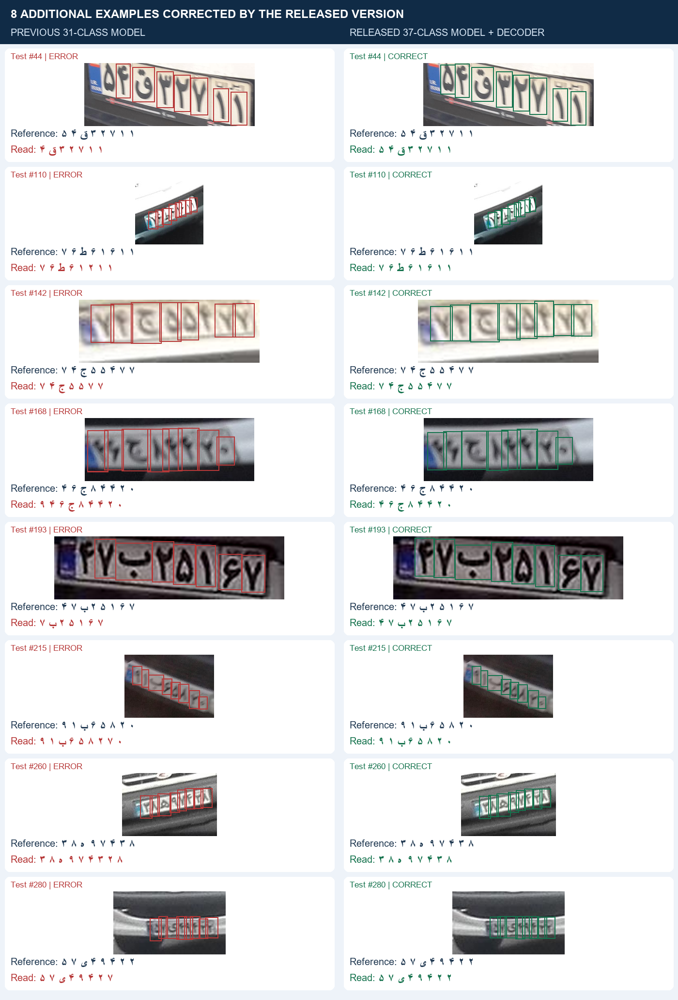
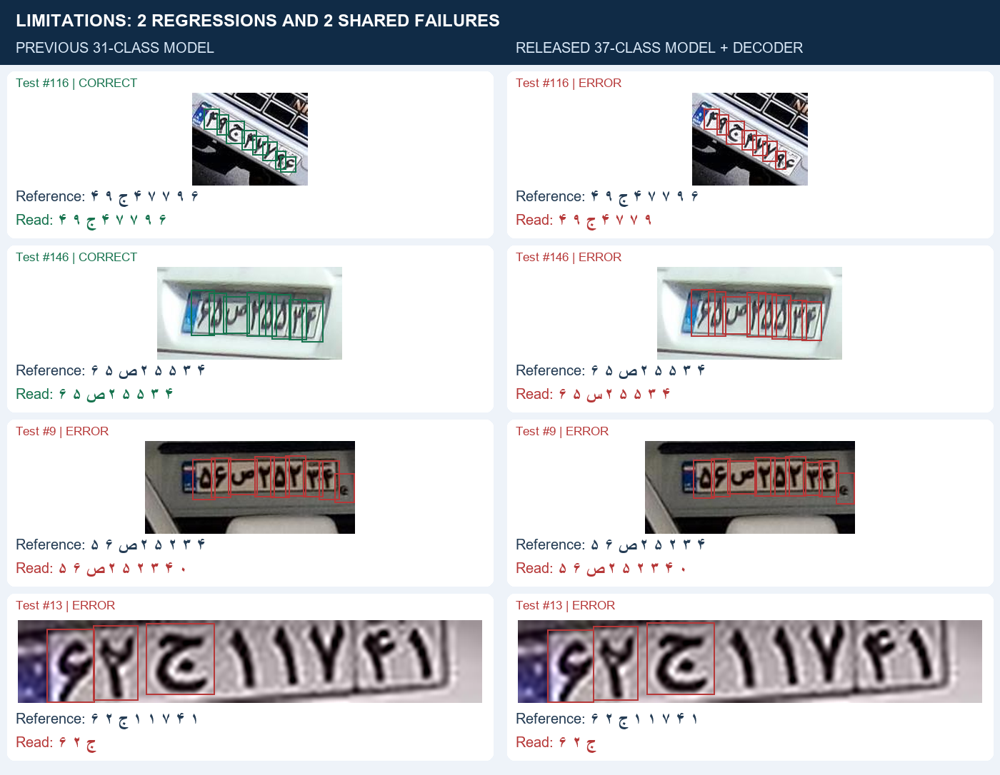

# Additional previous/released model comparisons

The released 37-class model plus decoder is compared with the original 31-class model on identical HezarAI test crops. This uses the original frozen prediction caches, not newly trained experimental weights.

## Complete test-pair accounting

| Outcome on the same 995 images | Images |
|---|---:|
| Both versions correct | 816 |
| Released version corrects an old error | **49** |
| Released version introduces an error | **11** |
| Both versions wrong | 119 |

Thus the old model reads 827/995 complete plates correctly (83.12%) and the released version reads 865/995 (86.93%): **38 net additional correct plates**, including both weight and decoder changes. This is not proof of universal improvement.

## Eight additional improvements

The first eight newly correct test indices in ascending order are 44, 110, 142, 168, 193, 215, 260 and 280. Previously displayed indices 0, 1, 40 and 80 and repeated reference strings were excluded. These improvements include missing characters, extra detections and substitutions. They deliberately illustrate gains; they are not a random sample or a new benchmark.

## Regressions and remaining errors

The first two additional regressions are indices 116 and 146. Two additional shared failures are also shown. The same ascending-index and distinct-reference rules apply; exact selections and detections are in [comparison.json](comparison.json).

## Provenance and limits

- Dataset: [HezarAI Persian License Plate v1](https://huggingface.co/datasets/hezarai/persian-license-plate-v1), designated test split, revision `3ca8609f245f0aab2c4f1d93986ecebc6b923081`. Images remain attributed to the upstream source; no new license is asserted for them.
- Old weights SHA256: `dc8e83b4442d6d88a47083c69cf9c65c99fb0fc37162e64e941088e35821ffa5`.
- Released weights SHA256: `5ab6da27dedafc06f6c69d29c297d9f270c24fa5f0130d1d15fff40ebe9d56c8`.
- Input 640, confidence 0.25, class-aware model NMS IoU 0.7, FP32. Previous cache used automatic letterboxing; released cache used square letterboxing and additional duplicate suppression at IoU 0.5.
- Green/red denotes entire normalized string agreement with the reference, not correctness of each individual box. Text is displayed in physical left-to-right character order, with visual spacing.
- These are already-cropped plates. Full-frame localization, live cameras, near-duplicate independence and complete reference-label correctness are not established. These test results have been inspected and must not tune future models.
