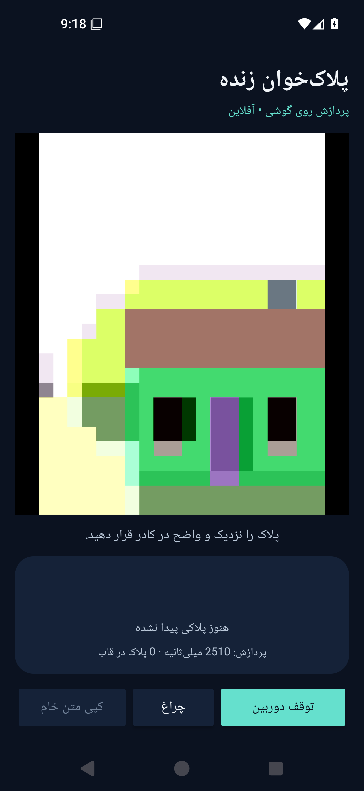

# Android live-camera preview — 4 November 2026

This adds a native installable application around the released v0.2.0 NCNN models. It is an application integration release, not a newly trained model or an additional accuracy improvement.

## Download and use

[PlateLens-0.1.0-preview.apk](https://github.com/Amir-chi/Iranian-Plate-Recognition-Model/releases/download/android-v0.1.0-preview/PlateLens-0.1.0-preview.apk) · [SHA256](https://github.com/Amir-chi/Iranian-Plate-Recognition-Model/releases/download/android-v0.1.0-preview/PlateLens-0.1.0-preview.apk.sha256) · [Source, build instructions and limitations](../../android-app/README.md)

Android 8.0/API 26 minimum. Universal package: arm64-v8a, armeabi-v7a, x86_64. Install the APK, open **پلاک‌خوان**, tap **شروع دوربین** and grant camera access. The rear camera feeds a native plate locator; its clean crops feed the character reader. The result card displays the actual crop and raw character sequence. Unsupported layouts are marked uncertain rather than repaired or truncated.

Only the camera platform permission is requested. Models are bundled; the app declares no Internet permission and saves/uploads no camera frames. Clipboard copying is explicit. This is a development-signed sideload preview, not a Play Store distribution. Keep third-party notices with the app.

## Validation

- APK compilation, JVM unit checks and Android lint completed successfully. Lint warnings about newer dependencies/SDK and ignored older-platform accessibility attributes remain; this is not a zero-warning build.
- Three JVM tests cover standard-shape validation and preview coordinate geometry.
- Two instrumented tests run on an Android 15/API 35 x86_64 Pixel 5 emulator. Native NCNN inference reproduces all five expected full-frame fixture strings; a camera frame reaches native analysis, and stopping the camera updates its state.
- The five fixtures are previously used integration examples, with repeated views of one car. They are not five independent accuracy measurements or an unseen benchmark.
- APK ZIP integrity, bundled model hashes, native ABI presence and manifest requested permissions are checked separately; see `apk-verification.json`.

The emulator results do not establish ARM phone FPS, sustained temperature/battery use, minimum-memory performance, optical camera accuracy or physical-phone overlay alignment. Those need a real target device. No phone model or performance promise is assumed.

## Actual emulator interface

The preview scene is generated by the emulator camera, not a real plate photograph. The screenshot documents the running interface; it is not an OCR accuracy example. The separate fixture test above exercises real plate images through both native models.

## Build identity

- APK source: `f36e84b1ff8ac5c6936f2f1714a91ca0a85cec87`.
- Successful [CI run 41805689612](https://github.com/Amir-chi/Iranian-Plate-Recognition-Model/actions/runs/41805689612).
- APK: 65010493 bytes; SHA256 `783e68433a326272973e837ec2cdc70a422dcfec439a9e9f4dfff17cd71ef211`.
- [Instrumented JUnit result](instrumentation-tests.xml): 2 tests, 0 failures/errors/skips.
