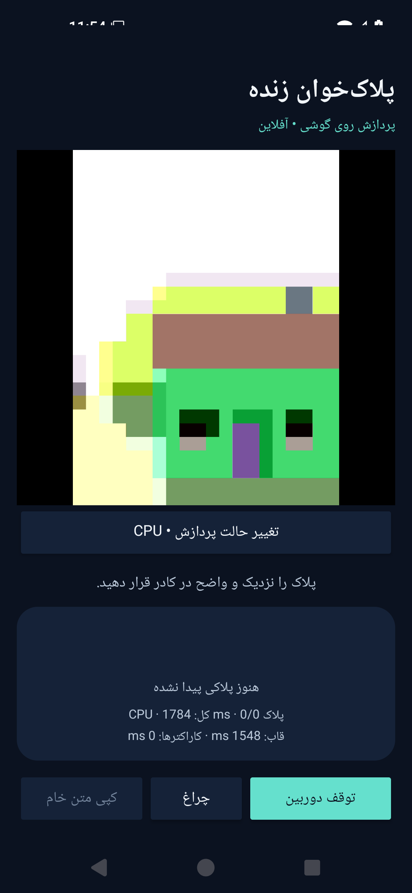

# Android latency correction — 4 November 2026

## Trigger and intended behavior

The user reported approximately **2,500 ms per analysis on a Samsung A52s 5G** with the original 0.1.0 preview, with worse behavior when multiple plates were present. This is user-observed timing, not a controlled local device benchmark. The original app used CPU-only inference and waited for every character-reader invocation before publishing any result. Its detail card showed only the first plate, while other plates had boxes without text.

The 0.1.1 preview requests NCNN Vulkan acceleration, falls back to CPU when GPU availability/model loading/inference fails, and allows forcing CPU with the processing-mode button. The UI displays the **actual backend**, complete analysis duration, locator duration and cumulative character-reader duration. First-run shader/model setup is excluded from any steady-state claim: compare warmed-up readings on the same scene.

Completed OCR results are now published while later plates are still being processed. All retained plates receive their own token label; unread plates have numbered placeholders. The first result no longer waits for all readers. Up to five plates are still read sequentially, so total frame time can grow with plate count. No tracking, reduced-resolution model, quantization or retraining was introduced.

## Model and scheduling preservation

The locator and character weights remain exactly those in the v0.2.0 model bundle. Letterbox input stays 640 × 640, with the existing confidences and suppression settings. FP16 arithmetic remains disabled. CPU execution uses at most four reported big-core threads; Vulkan-capable models can still have individual CPU layers.

The minimum interval between analysis starts changes from 350 ms to 100 ms. This only removes an artificial throughput cap when inference is already faster; it cannot make a 2,500 ms inference itself faster. CameraX still keeps only the latest pending frame. A session generation invalidates late results after camera stop/restart or backend change. Thumbnail allocations are recycled after replacement rather than left to accumulate between frames.

## Reproduce on the phone

[Download 0.1.1 preview](https://github.com/Amir-chi/Iranian-Plate-Recognition-Model/releases/download/android-v0.1.1-preview/PlateLens-0.1.1-preview.apk). Development APKs from separate CI runs may have different signing keys; uninstall the old preview if Android rejects updating it. No saved plate history exists in this prototype.

1. Open the app, grant camera access, and check that the backend reads `GPU (Vulkan)`.
2. Let the models warm up, keep a clear single plate in view, and record several total / locator / reader times and reading errors.
3. Press the processing-mode button to force `CPU`, and repeat the same scene. Switching reloads the models and camera.
4. Repeat with two or more plates. Check each plate's label and the completed/total count. Frame time and first-result time are different measurements.

**No new A52s speedup or real-camera accuracy figure is claimed yet.** A GPU request alone does not prove faster execution, correct driver behavior or unchanged predictions on that phone. The user's repeated device test is required. The original 995-image desktop model benchmark must not be relabeled as a phone benchmark.

## Build and automated evidence

The source uses the pinned NCNN 20261020 Android Vulkan SDK, verified by SHA256. It is built with NDK 30.0.16248370 to match the newer runtime required by that prebuilt SDK. Third-party notices remain bundled. See the [upstream Vulkan instructions](https://github.com/Tencent/ncnn/wiki/vulkan-notes) and [SDK release](https://github.com/Tencent/ncnn/releases/tag/20261020).

Tests cover the five existing full-frame fixture strings with forced CPU and requested GPU, a synthetic two-plate montage with incremental delivery and CPU/automatic text parity, and live camera start/stop plus switching to CPU and receiving a new analyzed frame. The montage checks integration behavior; it is not a naturally captured two-vehicle accuracy dataset. If the emulator has no supported Vulkan device, automatic mode exercises fallback and does not validate a physical GPU.

Software/virtual Vulkan devices are excluded from accelerator selection. The first software-Vulkan emulator attempt lost the entire emulator after five successful CPU fixture readings, before completing the GPU pass; it is not a passed GPU test. The corrected selection uses integrated/discrete hardware devices and keeps CPU execution for the emulator. Hardware Vulkan predictions and speed still require physical-phone testing.

## Square-frame pixel corruption regression

The synthetic 640 × 640 montage exposed a separate native preprocessing bug. When resizing and padding were both no-ops, NCNN could return a shallow alias of the RGB frame. In-place division by 255 then modified the full frame before plate crops were extracted; the character reader normalized those already-normalized crops again. Both plate boxes were found but both readings were empty. The same montage was read correctly by the existing PyTorch pipeline on this computer.

The native preprocessing now clones only when its normalization input aliases the source RGB buffer. The two-plate regression requires the exact texts **۹۹ل۵۴۵۳۳** and **۳۱ن۸۸۲۱۰**, as well as incremental delivery and CPU/automatic parity. Merely detecting two boxes or comparing two empty readings is no longer accepted. This reproduces a square-frame bug; it does not establish that the user's camera frame had that exact geometry.

## Verified final build

- [Successful CI run 41824073836](https://github.com/Amir-chi/Iranian-Plate-Recognition-Model/actions/runs/41824073836), source `17eb9be60d0f76b5418a32f139731514ecae582b`.
- Build, three JVM tests and Android lint passed. Lint warnings remain; this is not a zero-warning build.
- [Instrumented tests](instrumentation-tests.xml): three tests, zero failures/errors/skips. Five full-frame fixtures were each read correctly twice, with forced CPU and automatic CPU fallback. **No hardware GPU inference was exercised in the successful emulator run.**
- The synthetic two-plate frame now reads both exact strings, and the first reading is delivered before the second; see [structured evidence](summary.json).
- [APK verification](apk-verification.json) checks ZIP integrity, all model hashes, three ABIs and camera-only platform permission. The Vulkan shader compiler notice is bundled.
- APK: 79860149 bytes, SHA256 `cddc86a199ff2a5c89239bb90bdda646a3f9c0914ca0b5122590c957c5fdc09f`.

This is the emulator's generated camera scene, with CPU fallback visible. It is not a phone screenshot, a real-plate accuracy example or proof of faster A52s execution.
