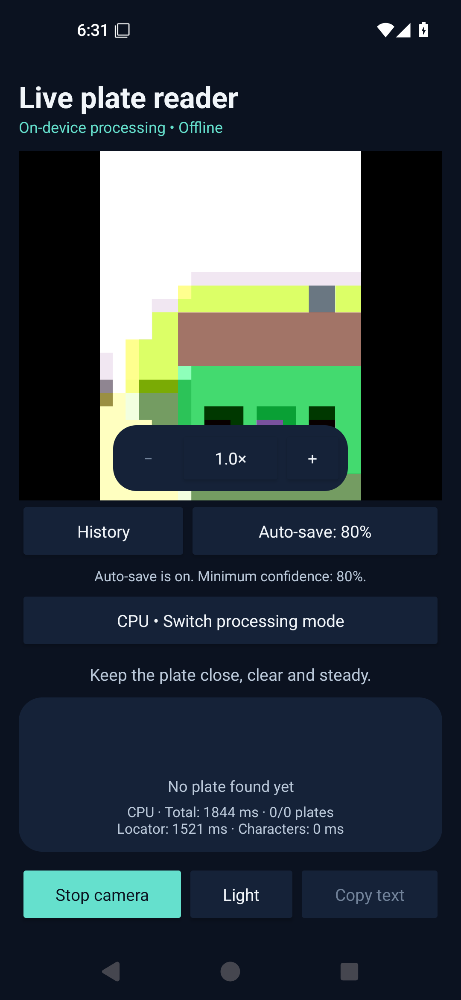
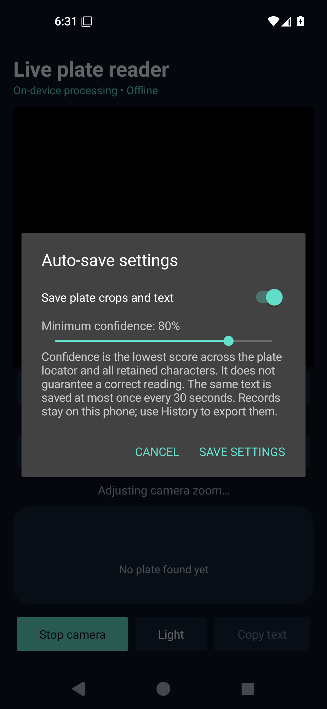
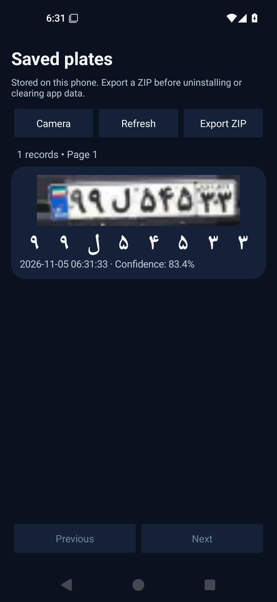

# English UI and local plate records — 5 November 2026

The 0.1.3 Android preview translates all application UI to English and adds local plate image/text history. Raw Persian plate content is preserved. Auto-save defaults to **80%**, adjustable from 1–100% or disabled in the settings dialog.

Save confidence is the minimum of the locator and all retained character scores, not the locator alone. Empty/missing-character-score results are rejected. All eligible plates in a frame are handled separately; the same raw text has a persistent 30-second save cooldown. Scores are not calibrated correctness probabilities, and layout checks do not change raw readings.

Clean crops (JPEG, at most 640 pixels on the longer side), UTF-8 text/tokens, epoch time, individual scores, threshold and layout status are stored together in an atomic SQLite row. Encoding/writes use a bounded background queue rather than the camera/UI worker. No retention deletion is performed. History paginates 50 rows and exports a snapshot as image files plus `records.json` using Android's document picker.

The app remains offline with camera-only platform permission. Records are private app data; uninstall/clear-data removes them, so export first. See [app use and backup instructions](../../android-app/README.md). Android [app-specific storage](https://developer.android.com/training/data-storage/app-specific) and [document export](https://developer.android.com/training/data-storage/shared/documents-files#create-file) explain those platform semantics.

A dedicated persistent preview key is configured in CI for this and subsequent updates. Earlier 0.1.0–0.1.2 development APKs used different keys and may require one uninstall to move to 0.1.3; those versions had no saved plate history. Private signing material is kept outside Git and decoded only into the CI runner's temporary directory. The distributed APK signature must match the retained public certificate fingerprint.

The model weights, inference input size, decoder and zoom pipeline remain unchanged. This is an app feature release, not a new model accuracy or A52s speed claim.

## Verified build and evidence

- [CI run 41980450558](https://github.com/Amir-chi/Iranian-Plate-Recognition-Model/actions/runs/41980450558), APK source `dfb25dc2f0e195158616461e0d2b941d1ce04901`.
- Build, three JVM tests and lint completed successfully; warnings remain. [Seven instrumented tests](instrumentation-tests.xml) passed with zero failures/errors/skips on Android 15/API 35 x86_64.
- Tests reject a weak locator or any weak character, accept the 80% boundary, preserve rows across reopen, suppress duplicates inside 30 seconds, save again at the boundary, verify independent background crops, and match exported JPEGs to UTF-8 JSON records. Settings are changed from 80% to 85% through the real dialog and restored to 80% after verifying persistence.
- Existing five-image OCR, two-plate, zoom and camera lifecycle checks still pass; character confidence output is checked against the native minimum. These previously used fixtures are integration checks, not a fresh accuracy benchmark or hardware GPU measurement.
- [APK verification](apk-verification.json) confirms unchanged model hashes, three ABIs and camera-only requested platform permission. [APK signature verification](apk-signing.txt) matches the retained persistent certificate.
- APK: 79893722 bytes; SHA256 `90ce93f4e8a89cd6410cebbabf32da1e5422033f715f1c699fdaba7934120593`.
- Saved text remains a model prediction, not verified ground truth. Confidence filtering is not an accuracy certification.

## Actual emulator UI

The history screenshot is seeded from the actual native reading of the first existing public full-frame fixture (83.4% minimum score). The settings screenshot shows the default 80% value. The camera scene itself is generated by the emulator. None of these screenshots represents physical A52s validation or the user's private camera logs.
