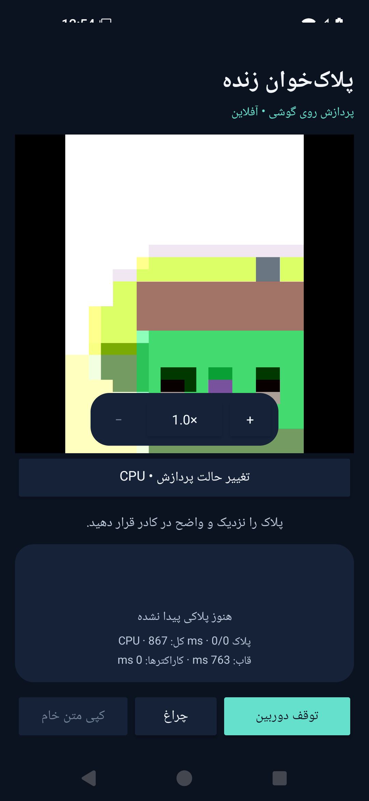

# Android camera zoom — 4 November 2026

The 0.1.2 preview adds camera zoom to the offline live OCR app. Spread/pinch two fingers on the preview, or press **+ / −**. Tap the displayed ratio to reset to 1×. The requested ratio is preserved across camera restart/backend changes within the activity. Zoom limits are read from the attached camera; unavailable controls are disabled.

`CameraControl.setZoomRatio` controls the camera shared by Preview and ImageAnalysis. No view-scale transform is used. See the [CameraX common controls and zoom contract](https://developer.android.com/media/camera/camerax/configuration#zoom). During a pending change, analysis pauses; previous reading/crop/boxes are cleared and older in-flight results are invalidated. Only the latest request completion resumes analysis. Buttons provide a 48dp alternative to the multi-finger gesture and have Persian accessibility labels.

This does not change model weights, model inputs or the OCR decoder. Digital zoom cannot recover image detail that the camera did not capture. No optical-zoom, A52s speed or accuracy improvement is claimed. Camera-specific limits and real-phone behavior still require device testing.

[Download APK](https://github.com/Amir-chi/Iranian-Plate-Recognition-Model/releases/download/android-v0.1.2-preview/PlateLens-0.1.2-preview.apk) · [Checksum](https://github.com/Amir-chi/Iranian-Plate-Recognition-Model/releases/download/android-v0.1.2-preview/PlateLens-0.1.2-preview.apk.sha256) · [App instructions](../../android-app/README.md)

Development signing may require uninstalling an older preview before installing this one. Camera remains the only requested platform permission.

## Verified build

- [CI run 41832651163](https://github.com/Amir-chi/Iranian-Plate-Recognition-Model/actions/runs/41832651163), APK source `a0a4df184d2d426482d6f8b482bf5c0c723c6a2f`.
- Build, three JVM tests and lint passed; lint warnings remain. [Three instrumented tests](instrumentation-tests.xml) passed with zero failures/errors/skips on Android 15/API 35 x86_64.
- The emulator supported zoom. **+**, injected two-finger spread, and reset each changed CameraX ZoomState and were followed by a fresh analyzed frame. Stopping the camera disabled zoom buttons; backend switching still restarted analysis. See [summary](summary.json).
- The existing five reference fixture strings and the exact two-plate regression still passed. Models and camera-only platform permissions were verified in the [APK check](apk-verification.json).
- APK: 79863061 bytes; SHA256 `2556d5e74111984c4a4889ae9f7a6d141bba3f540c590ea674f5ac2df15a0bdb`.

The camera scene is generated by the emulator. This screenshot is not a real-phone accuracy example or evidence of a particular phone's maximum zoom.
