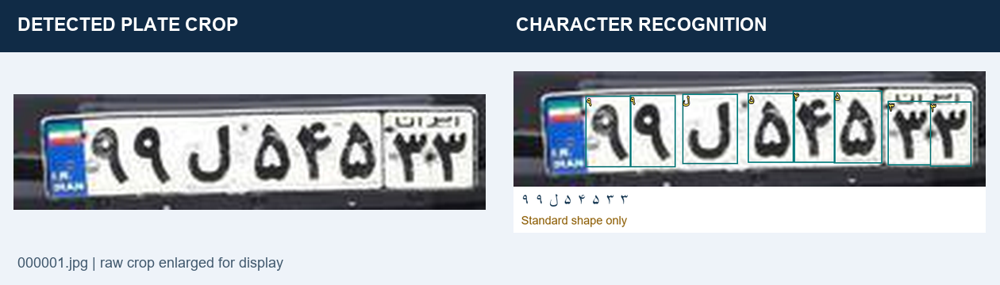
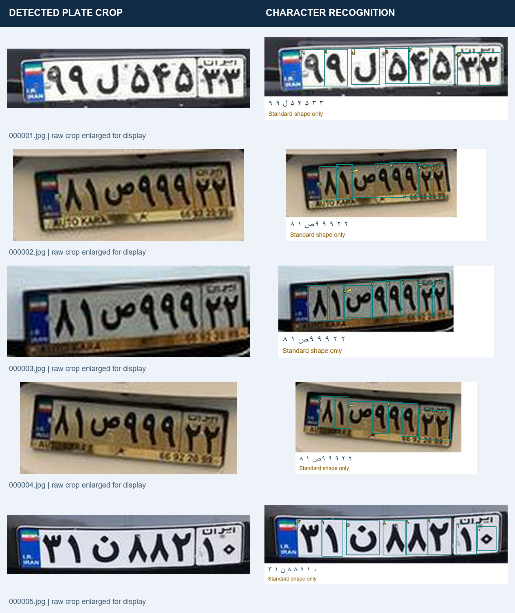

# Detected crop → character recognition — 4 November 2026

The output shown here is the **cropped plate**, followed by character detections and decoded text. Each crop was actually detected in a full vehicle image, not manually supplied as an already-cropped plate.

## All five examples

These are the first five test inputs in filename order from [roozbehrajabi/ALPR_Dataset](https://github.com/roozbehrajabi/ALPR_Dataset/tree/51da29fd58e8f772f5daf224f7f52967277fcf29/YOLOv3_Dataset/Test/input), pinned revision `51da29fd58e8f772f5daf224f7f52967277fcf29`. Images 2–4 show the same vehicle. No successful-example filtering was applied. Images remain attributed to their upstream source; no new license is asserted for them.

## Models and settings

1. Full-frame localization: existing `models/plate_detector.pt`, input 640, confidence 0.5, square letterboxing. Detected boxes are expanded by five pixels and clipped to image boundaries.
2. Character recognition: released `models/chars37-best.pt`, input 640, confidence 0.25, class-aware NMS IoU 0.7, duplicate suppression IoU 0.5, square letterboxing and FP32. Only clean crop pixels enter this model; display overlays are drawn afterward.
3. Read retained characters from left to right, normalize text and report supported standard text shape. Do not impose an eight-character count or invent missing characters. A supported shape does not establish a correct reading.

These samples use the released weight, **not** the later local experimental checkpoints. No new training was performed for this demonstration. The five examples are not an independent accuracy benchmark: overlap with prior training is not established, and no independent character-level reference audit was performed. No live camera was used.

## Evidence and individual files

[results.json](results.json) records source links, input and model hashes, plate/crop coordinates, detector confidences, retained character boxes and text. Character coordinates are relative to each clean crop; add crop offsets for full-frame coordinates. Clean crops are unchanged decoded image regions saved losslessly; montage enlargement is for display only.

| Source input | Clean detected crop | Character output |
|---|---|---|
| 000001.jpg | [Crop](000_000001_plate0_clean.png) | [Characters](000_000001_plate0_characters.png) |
| 000002.jpg | [Crop](001_000002_plate0_clean.png) | [Characters](001_000002_plate0_characters.png) |
| 000003.jpg | [Crop](002_000003_plate0_clean.png) | [Characters](002_000003_plate0_characters.png) |
| 000004.jpg | [Crop](003_000004_plate0_clean.png) | [Characters](003_000004_plate0_characters.png) |
| 000005.jpg | [Crop](004_000005_plate0_clean.png) | [Characters](004_000005_plate0_characters.png) |
