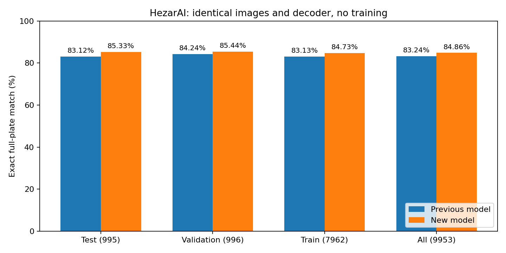

# HezarAI full-dataset OCR evaluation — 1 November 2026

## Conclusion

The candidate reads more complete plates correctly on each supplied split. On the designated **test** split, exact full-plate match improves from **83.12% (827/995)** to **85.33% (849/995)**: **+2.21 percentage points**. Across all splits the candidate reads **161 additional plates** correctly (8,446 vs 8,285 out of 9,953). This is evidence of an improvement on this benchmark with the fixed decoding settings, not a guarantee of general superiority or coverage of all 37 classes.

## Source and integrity

Dataset: [hezarai/persian-license-plate-v1](https://huggingface.co/datasets/hezarai/persian-license-plate-v1). The downloaded revision and SHA256 of each original parquet file are recorded in `provenance.json`. The dataset card attributes the source to an Amirkabir University collection and the text labels to its authors.

All **9,953** rows were evaluated: 7,962 train, 996 validation, 995 test. These names refer to the upstream dataset splits: neither model was trained or tuned on them during this evaluation. Train/validation scores are supplementary; the designated test split is reported separately. No image failed decoding and no row was silently dropped.

All prior 56,178 prepared IR-LPR image hashes were checked. There were **zero exact byte or exact decoded RGB-pixel/dimension matches** to any prior train, validation or test image. There were no exact decoded-pixel duplicates within the HezarAI data. This check does not detect resized, differently compressed, cropped or otherwise near-duplicate images. Independence from prior data or unknown original baseline pretraining is not proven.

## Method

Both frozen checkpoints ran locally on an RTX 4060 Laptop GPU with PyTorch 2.7.1+cu118. The SHA256 of each checkpoint is in `summary.json` and matches the checkpoints used in the previous comparisons. Settings were fixed before evaluation: image size 640, batch 8, GPU 0, confidence 0.25, NMS IoU 0.7, FP32. No new model was downloaded or trained.

The input images are already cropped plates. The whole-image plate detector was not used or evaluated. Each character detector predicts boxes; all retained detections are ordered by horizontal box center and concatenated. No ground-truth-dependent filtering, fixed-length trimming, grammar correction, confidence sweep or manual output corrections are applied. Normalization uses NFKC, Persian digits, Arabic/Persian letter equivalences, removes whitespace/joiners/directional marks, maps الف to ا and آ to ا, and maps the disability class to ژ. A sample plate was visually checked to verify the text order.

There are **29 labels containing + or #**, whose semantics are unverified. They remain in the conservative all-row exact-match and CER results; neither symbol was mapped by guesswork. Separate results excluding only those ambiguous labels are in `summary.json` (`mappable_by_split`). This subset does not establish that every other label is error-free.

Exact match requires the entire normalized predicted string to equal the normalized reference. CER is total Levenshtein substitutions/deletions/insertions divided by total reference characters; lower is better. This dataset supplies text, not character boxes, so detection mAP cannot be computed from these labels. **The percentages below must not be compared directly with previous mAP values.**

## Results

| Split | Images | Previous exact match | New exact match | Previous CER | New CER |
|---|---:|---:|---:|---:|---:|
| test | 995 | 83.12% | 85.33% | 3.76% | 3.15% |
| validation | 996 | 84.24% | 85.44% | 4.23% | 3.51% |
| train | 7962 | 83.13% | 84.73% | 3.87% | 3.43% |
| all | 9953 | 83.24% | 84.86% | 3.90% | 3.41% |

## Paired uncertainty

Each image is compared against itself across models. Bootstrap intervals resample image pairs 2,000 times, seed 0. They assume independent images; unrecognized capture/session clusters could make uncertainty larger. These are descriptive intervals, without correction for multiple reported splits.

| Split | Only new correct | Only old correct | Both correct | Accuracy delta | Paired 95% interval |
|---|---:|---:|---:|---:|---|
| test | 38 | 16 | 811 | +2.21 pp | [+0.80, +3.62] pp |
| validation | 30 | 18 | 821 | +1.20 pp | [-0.20, +2.51] pp |
| train | 264 | 137 | 6482 | +1.60 pp | [+1.12, +2.11] pp |
| all | 332 | 171 | 8114 | +1.62 pp | [+1.19, +2.07] pp |

## Interpretation and next step

The candidate has the better point estimate on this full-plate OCR benchmark, including the designated test split. Use this as additional evidence alongside the earlier mixed results. Keep both frozen weights and compare on the actual target camera before replacing the default. Class-specific coverage of the six added outputs is not established by an overall string-match score. More epochs alone are still not justified by the previous early-stopping curve.

No server or paid training resources were used. Raw row-by-row predictions, reference strings, boxes/confidences, original parquet files and the execution script remain locally at `D:/PlateLocalTest/hezarai-20261101/`. Only aggregate metrics, provenance and the generated plot are included here; upstream data and full label transcripts are not redistributed. The aggregate checks and paired image identities were verified after execution.
