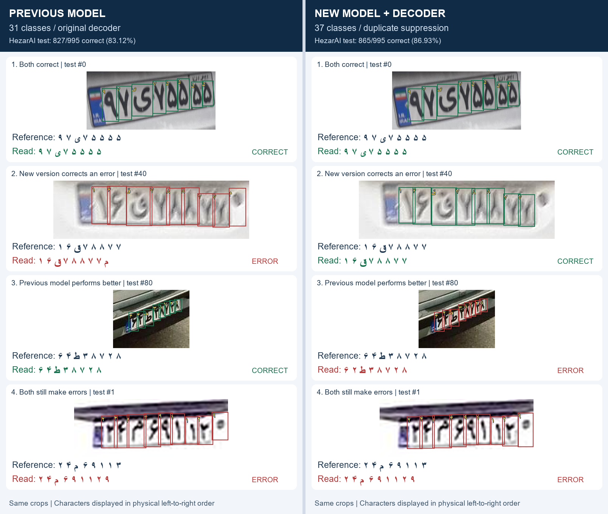

# Visual comparison — previous model vs v0.2.0

Separate full-resolution panels: [previous model](previous-predictions.png) and [new model + decoder](new-predictions.png).

## What is shown

Four identical plate crops from the designated test split of [HezarAI Persian License Plate v1](https://huggingface.co/datasets/hezarai/persian-license-plate-v1), revision `3ca8609f245f0aab2c4f1d93986ecebc6b923081`. Images and reference labels remain attributed to the upstream dataset; no new license is asserted for them.

- Previous: `models/best.pt`, 31 classes, original decoder; SHA256 `dc8e83b4442d6d88a47083c69cf9c65c99fb0fc37162e64e941088e35821ffa5`.
- New: release `chars37-best.pt`, 37 classes, confidence 0.25 and cross-class duplicate suppression at IoU 0.5; SHA256 `5ab6da27dedafc06f6c69d29c297d9f270c24fa5f0130d1d15fff40ebe9d56c8`.

The comparison uses recorded predictions from the published evaluations; no model was retrained, no thresholds changed and no images regenerated. Both used input size 640, FP32 and model NMS IoU 0.7. The historical baseline cache used automatic letterboxing; the new release cache explicitly used square letterboxing (`rect=False`). This compares the documented previous and released pipelines, rather than isolating the effect of network weights alone.

Character boxes and labels are drawn from detections. The new panel displays boxes retained by the release decoder. Green/red marks **whole-string agreement with the dataset reference**, not whether every individual box is right/wrong. `Reference` and `Read` display characters in physical left-to-right order to avoid bidirectional text reordering; spaces are visual separators, not predicted characters. Crops are resized with preserved aspect ratio for display only.

## Selection and limitations

Select the first ascending test index in each category, using the already-frozen predictions:

| Row | Test index (zero-based) | Previous | New |
|---|---:|---|---|
| Both correct | 0 | Correct | Correct |
| New version corrects an error | 40 | Error | Correct |
| Previous model performs better | 80 | Correct | Error |
| Both still make errors | 1 | Error | Error |

This deliberately includes improvements and failures. Four selected examples cannot estimate accuracy. The full 995-image test benchmark remains **827/995 (83.12%)** for the previous pipeline and **865/995 (86.93%)** for the released pipeline. Those totals were checked against the prediction caches when producing these images.

These are already-cropped plates; they do not evaluate full-frame plate localization or a live camera. References are upstream dataset labels, not a new manual annotation audit. These test examples have been inspected and must not guide further model or threshold selection.

[Example manifest](examples.json) records image hashes, original source names, exact reference/prediction strings and selection rules. Full evaluation settings and limitations: [original OCR report](../hezarai-2026-11-01/REPORT.md), [decoder report](../ocr-improvement-2026-11-01/REPORT.md).
